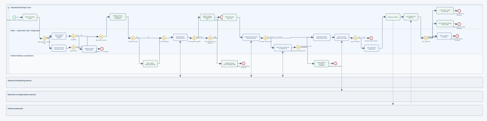
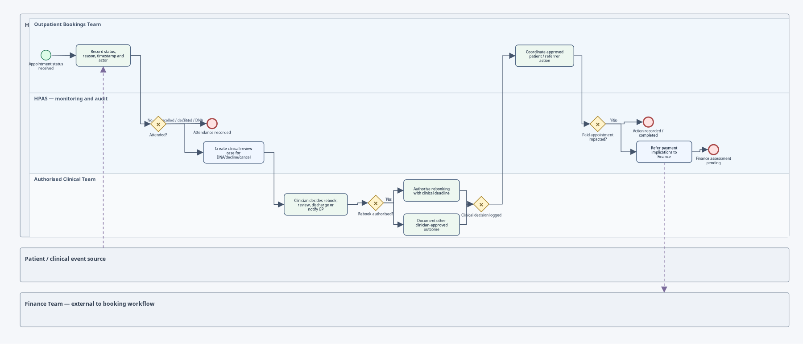
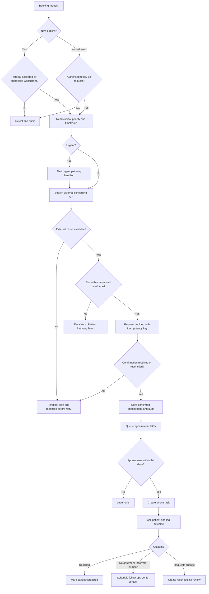
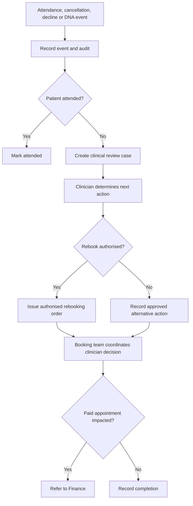

# HPAS — Appointments & Scheduling (FR 2.1–2.5)

**Module:** UFCFAF-30-3 — Development of Information Systems Project  
**GitHub issue:** #6, *Operational BPMN for Outpatient Appointment Booking & Notifications*  
**Status:** Operational design proposal for portfolio review; **not implemented clinical software**.

## 1. Scope and source of truth

This deliverable models the appointment pathway after clinical referral review. It includes new-patient and clinician-authorised follow-up requests, priority and timeframe checks, the external scheduling system, routine letters and telephone contact, scheduling failures, and cancellation/decline/Did Not Attend (DNA) events.

**Important correction:** The original case study (p. 2) says patients are **normally informed by letter**, and **if an appointment is within the following two weeks the patient must also be telephoned**. Accordingly, **14 days or less = letter + telephone**; **more than 14 days = letter**. The repository README abbreviates this in a potentially contradictory way; the team should reconcile wording before final submission. The diagram follows the case study.

Also, GitHub Issue #6 uses **FR-04** in its title, while the README groups Appointments & Scheduling under **FR 2.1–2.5**. This design maps to the README numbering and flags the discrepancy without silently rewriting team-owned requirements.

## 2. Editable BPMN 2.0 models

- [`bpmn/outpatient-booking-notifications.bpmn`](bpmn/outpatient-booking-notifications.bpmn): booking authorisation, urgent routing, search and selection, anti-silent booking, reconciliation, letter and phone notification.
- [`bpmn/appointment-cancellation-dna.bpmn`](bpmn/appointment-cancellation-dna.bpmn): attendance status, cancellation/decline/DNA, clinician-authorised next steps and Finance hand-off.

### Rendered previews

The PNGs above are read-only previews. The `.bpmn` versions are the editable assessment artefacts, and `.svg` versions are included for high-resolution reference.

Both files contain BPMN 2.0 XML with collaboration, pools, lanes, service/user tasks, gateways, sequence and message flows, plus diagram layout information (BPMN DI). Open and edit them with Camunda Modeler or another BPMN 2.0-compatible modeler. They are **non-executable** analysis models; do not deploy them as production workflows.

**Why separate diagrams?** The second diagram is an event-triggered follow-on process for appointment outcomes. Keeping the booking and outcome processes separate makes the operational model readable while retaining the full FR 2.1–2.5 coverage. The same patient and appointment identifiers link the two processes in the intended application.

## 3. Actor responsibilities / swimlanes

| Actor | Allowed responsibilities | Must not do |
| --- | --- | --- |
| Consultant / authorised clinician | Accept new referrals; authorise follow-ups; specify priority and latest clinically acceptable date; decide rebooking, discharge and follow-on care. | Delegate clinical suitability or discharge decisions to the booking team. |
| Outpatient Bookings Team | Select suitable slot, coordinate booking, telephone patients, log call attempts, record cancellation/DNA and follow clinician-approved next steps. | Accept unapproved new referrals, silently extend clinical deadline or make discharge decisions. |
| HPAS rules / integration | Check clinical authorisation, coordinate scheduling, enforce time window, queue letters and calls, audit actions, reconcile ambiguous API responses. | Reinterpret clinical priority or silently confirm out-of-window slots. |
| Patient Pathway Coordinators | Resolve delayed/urgent pathways and obtain an authorised clinical decision if timing needs to change. | Approve a later clinical deadline without clinician authority. |
| External scheduling provider | Supply availability and booking reference / status. | Override HPAS authorisation or clinical deadline. |
| External correspondence provider | Deliver routine letters and return status. | Decide if telephone contact is clinically or operationally required. |
| Finance Team | Determine financial disposition after paid cancellation/rescheduling. | Decide medical necessity or patient discharge. |

## 4. Business rules

| Rule | Testable specification | Traceability |
| --- | --- | --- |
| BR-01 | A **new patient appointment** is permitted only if referral status is `ACCEPTED`, with a recorded authorised Consultant decision; otherwise reject and log. | FR 2.1, NFR 1, NFR 2 |
| BR-02 | A **follow-up appointment** needs an authorised clinical order specifying the review timeframe; otherwise reject. | Case study p. 6, NFR 1 |
| BR-03 | Requests must include specialty, appointment priority, preferred timeframe and patient requirements. Search slots via an external scheduling API. | FR 2.2 |
| BR-04 | Available slot must be **within** the clinician-requested timeframe. If none fits, do not confirm a later slot; alert the Pathway Team and await authorised resolution. | FR 2.4 |
| BR-05 | Urgent requests must be flagged for expedited handling but **not** exempt from authorisation or slot deadline checks. | Case study p. 2, NFR 1 |
| BR-06 | After confirmation, always queue a routine appointment letter using the correspondence service. If date is in **14 days or less**, also create an administrative telephone task. | FR 2.3 and case study p. 2 |
| BR-07 | Log each telephone attempt and outcome: answered, unanswered, incorrect contact number, or requested another date. Follow up unresolved contact; do not falsely mark patient reached. | FR 2.3, NFR 2 |
| BR-08 | On API failure or an unknown booking result, keep request in a pending state, alert staff and **reconcile external status before retrying**. Never blindly duplicate a booking. | NFR 5 |
| BR-09 | Record cancellation, declined appointments and DNA, then send case to the clinical team. Only authorised clinical staff determine rebooking, follow-up, discharge or informing the referrer. | FR 2.5 |
| BR-10 | Paid cancellation/rescheduling must be referred to the Finance Team for any refund/transfer decision. | Case study p. 6, FR 4.6 |
| BR-11 | Log user/role IDs, timestamps, decision reason, external transaction references, notifications, unsuccessful attempts and escalations to immutable application audit records. | NFR 1–3 |

### 14-day interpretation

For this model, an appointment scheduled for **exactly** 14 days from notification processing counts as “within two weeks”. The live system must agree timezone, calendar/clock cutoff and what happens when a delayed notification process makes a previously >14-day booking fall inside the 14-day window.

## 5. Operational workflows (textual cross-check)

### 5.1 New patient and follow-up bookings

### 5.2 Cancellation, decline and DNA

## 6. Booking states and failure handling

| State | Entry reason | Next allowed action |
| --- | --- | --- |
| `RECEIVED` | Booking request logged | Validate authorisation |
| `REJECTED_AUTH` | New referral not accepted, or follow-up not authorised | No booking; audit and return to responsible clinician |
| `SEARCHING` | Request is authorised | Search provider using clinical constraints |
| `PATHWAY_REVIEW` | No slot within deadline | Pathway Team investigates; clinician may issue new authorised order |
| `PENDING_RECONCILIATION` | Provider is down or provider booking status is ambiguous | Investigate by persisted correlation/idempotency key, do not blindly rebook |
| `CONFIRMED` | Provider booking is known and in-window | Persist appointment and queue notifications |
| `LETTER_PENDING` / `LETTER_FAILED` / `LETTER_SENT` | Correspondence in flight | Monitor or retry notification without duplicating appointment |
| `CALL_REQUIRED` / `CALL_FOLLOW_UP` / `CALL_LOGGED` | Appointment within 14 days | Log each attempt and disposition |
| `CANCELLED` / `DECLINED` / `DNA` | Outcome received | Create clinical review; notify Finance if paid |

**Provider outage:** HPAS must preserve request intent locally, allow staff to record activity and recover when integration returns. A manual note is **not** a confirmed booking. If a timeout happens after a successful provider-side booking, query by stable correlation ID; otherwise a retry could create a duplicate.

**Correspondence outage:** Keep the appointment confirmed, but mark the notification separately pending/failed and notify the booking team. Do not silently assume a letter was delivered.

## 7. Proposed data model (logical, synthetic data only)

| Entity | Key attributes |
| --- | --- |
| `BookingRequest` | `request_id`, `patient_id`, `referral_id` or `followup_order_id`, `type`, `specialty`, `priority`, `clinically_latest_at`, `status`, `requested_by`, `created_at` |
| `Appointment` | `appointment_id`, `request_id`, `external_booking_id` (unique), `starts_at`, `ends_at`, `site`, `confirmed_at`, `status` |
| `BookingAttempt` | `attempt_id`, `request_id`, `idempotency_key`, `external_correlation_id`, `attempted_at`, `result`, `error` |
| `Notification` | `notification_id`, `appointment_id`, `type`, `status`, `provider_reference`, `created_at`, `sent_at` |
| `CallAttempt` | `call_id`, `appointment_id`, `handler_id`, `called_at`, `outcome`, `followup_task_id`, `notes` |
| `AppointmentOutcome` | `outcome_id`, `appointment_id`, `type`, `occurred_at`, `reported_by`, `reason` |
| `ClinicalDisposition` | `disposition_id`, `outcome_id`, `clinician_id`, `decision`, `rationale`, `authorised_at` |
| `AuditEvent` | `audit_id`, `actor_id`, `action`, `entity_type`, `entity_id`, `at`, `correlation_id` (append-only) |

All identifiers should be pseudonymous in screenshots, diagrams and test scenarios; no genuine patient information should enter a public repository.

## 8. Proposed external adapter interfaces

These are **proposed internal adapter contracts**, not confirmed endpoints of a real provider:

- `searchAvailability({requestId, specialty, priority, latestAcceptableAt, patientRequirements}) -> {slots, externalCorrelationId}`
- `createBooking({requestId, slotId, idempotencyKey}) -> {bookingId, status}`
- `getBookingByCorrelation({idempotencyKey}) -> {bookingId?, status}`
- `queueAppointmentLetter({appointmentId, recipientPreference, idempotencyKey}) -> {dispatchId, status}`

Store idempotency keys and provider references; verify every returned slot against the clinical deadline **server-side**. Protect access using role-based checks, an immutable audit trail and patient identity matching. Treat provider failure as an exception, not as authorisation to guess or bypass clinical rules.

## 9. Portfolio acceptance tests

| ID | Scenario | Expected result |
| --- | --- | --- |
| AT-01 | New patient referral `PENDING` | Booking blocked; no external API call; audited |
| AT-02 | New patient referral `ACCEPTED`, suitable slot exists | Exactly one booking confirmed |
| AT-03 | Authorised follow-up request | Schedule within clinical review window |
| AT-04 | No authorised follow-up request | Booking rejected and audited |
| AT-05 | Slot offered after Consultant's requested deadline | Do not confirm; Pathway Team alerted |
| AT-06 | Appointment in 10 days | Letter queued **and** telephone task created |
| AT-07 | Appointment in 21 days | Letter queued; no mandatory telephone task |
| AT-08 | Appointment exactly 14 days away | Letter queued **and** telephone task |
| AT-09 | Unanswered call or incorrect number | Call logged; follow-up task pending |
| AT-10 | Patient asks to change appointment | Log request; create controlled rescheduling case |
| AT-11 | Scheduling provider times out after successful booking | Reconciliation finds original booking; no duplicate |
| AT-12 | Provider reports no availability | No out-of-window confirmation; escalate |
| AT-13 | Patient DNA or cancels | Clinical review required before disposition |
| AT-14 | Paid appointment cancelled | Finance referral for refund/transfer decision |
| AT-15 | Urgent authorised referral | Expedited handling and timeframe checks; no bypass of approval |
| AT-16 | Correspondence service fails | Appointment retained; delivery failure logged for recovery |

## 10. Integration and scope boundaries

This task **does not** implement referral decisions, treatment appointments, funding/payment decisions, clinic letter authoring or actual scheduling API integrations. These belong to other team tasks. The BPMN consumes the result of Consultant authorisation and emits scheduling/notification events for the wider HPAS pathway.

**Recommended team review items:** agree FR-04 versus FR 2.1–2.5 naming; confirm the “letter plus phone” requirement; agree exact two-week date cutoffs, the urgent escalation SLA, permitted clinical reauthorisation paths, supported external scheduling API operations and a minimum number of phone re-attempts. The case study does not prescribe all these details.
